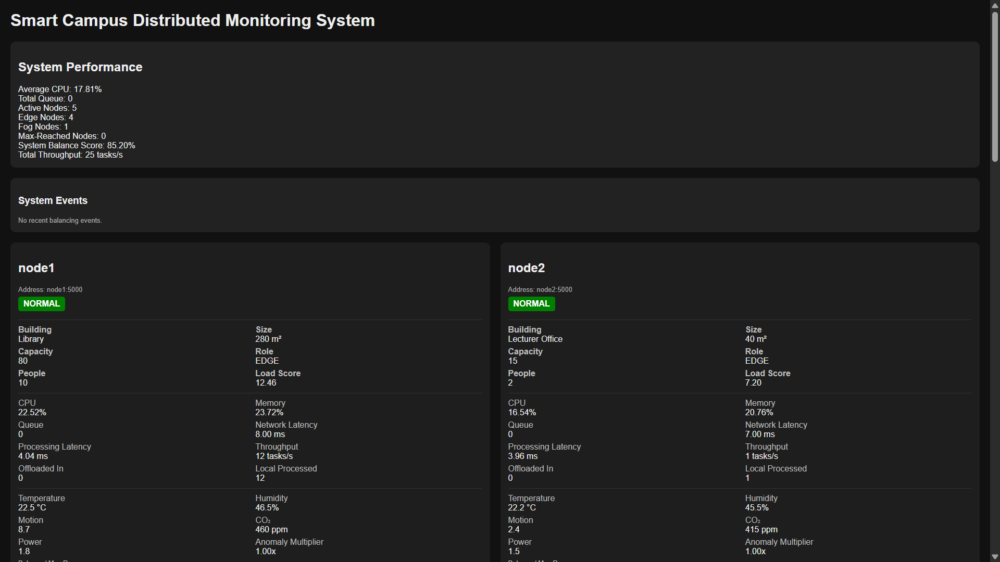
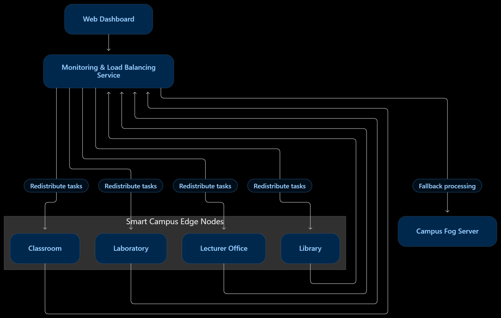

# 🧠 Smart Campus Distributed Load Balancing System

Welcome to the **Smart Campus Distributed System** project!

This project simulates a **distributed edge–fog computing environment** where smart campus buildings dynamically manage computational workloads using environmental sensor data.

The system demonstrates distributed monitoring, sensor-driven workload allocation, and communication between edge and fog nodes, providing a platform for exploring **performance transparency in distributed systems**.

---

# 📸 Screenshots



---

# 🏗 System Architecture



The system simulates a **smart campus distributed computing environment** composed of four edge nodes, a fog server, and a central monitoring service.

| Node | Role | Location | Capacity |
|------|------|----------|----------|
| node1 | Edge Node | Library | 80 |
| node2 | Edge Node | Lecturer Office | 15 |
| node3 | Edge Node | Laboratory | 50 |
| node4 | Edge Node | Classroom | 70 |
| fog1 | Fog Node | Campus Fog Server | 150 |

## Edge Nodes

Edge nodes represent **smart buildings equipped with simulated sensors**.

Each node processes environmental data locally and generates computational workloads based on sensor readings.

## Fog Node

The fog node acts as a **central processing fallback server**.

When suitable edge nodes cannot accommodate additional workload, the monitoring service can redirect processing load to the fog node.

## Monitoring Service

The monitoring service communicates with the nodes through HTTP endpoints to:

- Collect CPU and memory metrics
- Monitor processing queues
- Evaluate environmental sensor thresholds
- Identify workload imbalances
- Coordinate workload transfers
- Display system status and transfer events

---

# 🌡 Sensor Simulation

Each building node simulates several environmental and activity sensors.

| Sensor | Description |
|--------|-------------|
| People | Number of occupants in the building |
| Temperature | Indoor temperature level |
| Humidity | Air moisture level |
| CO₂ | Air quality level |
| Motion | Activity detection level |
| Power | Device energy consumption |

## Sensor Relationships

The sensors dynamically influence one another.

Examples:

- Increasing **people** increases **temperature, humidity, and CO₂**
- Higher **motion** increases **power consumption**
- Increased **power consumption** raises **temperature**
- Changes in environmental conditions influence simulated processing demand

These interactions approximate **smart building behaviour**.

---

# ⚠️ Node Status Types

Nodes can operate in several states.

| Status | Meaning |
|--------|---------|
| NORMAL | Normal edge-node operation |
| FOG-NORMAL | Normal fog-node operation |
| MAX-REACHED | A sensor has reached its maximum threshold |
| BALANCING-SEND | Node selected to send workload |
| RECEIVING | Edge node receiving workload |
| FOG-RECEIVING | Fog server receiving workload |
| OFFLINE | Node unavailable |

---

# ⚖️ Load Balancing Strategy

The monitoring service evaluates node performance using metrics such as:

- CPU utilization
- Memory utilization
- Queue length
- Sensor activity
- Processing load score
- Available node capacity

When workload imbalance is detected:

1. The monitoring service identifies heavily loaded edge nodes.
2. It evaluates available capacity on other edge nodes.
3. It selects eligible receiving nodes based on capacity and load differences.
4. It assigns processing workload to the receiving nodes.
5. If edge capacity is insufficient, the fog server can receive additional workload.
6. Transfer events and updated node metrics are displayed on the dashboard.

The implementation provides a simulation of distributed workload allocation.

---

# 📊 System Performance Evaluation

## Evaluation Objective

The evaluation examines how the simulated system behaves with and without the monitoring service's workload allocation decisions.

The comparison uses a fixed environmental scenario in which the **Library node reaches maximum sensor values**, while the other nodes remain near baseline conditions.

## Performance Comparison

The following values are calculated from the application's simulated performance formulas under a deterministic scenario.

**Note:** These are model-based calculations, not live Docker benchmark measurements.

| Performance Metric | Without Load Balancing | With Current Load Balancing |
|--------------------|-----------------------:|----------------------------:|
| Average CPU Utilization | 31.93% | 41.09% |
| Peak CPU Utilization | 88.65% | 88.65% |
| Average Simulated Processing Latency | 4.84 ms | 5.02 ms |
| Total Queue Length | 15 | 15 |
| Average Memory Utilization | 30.52% | 36.18% |
| Total Reported Processing Load | 103 | 118 |
| Assigned Workload Transfers | 0 | 15 units |

## Workload Allocation Example

During the simulated scenario, the monitoring service assigns workload from the overloaded Library node to other edge nodes.

| Source Node | Destination Node | Assigned Workload |
|-------------|------------------|------------------:|
| Library | Lecturer Office | 8 units |
| Library | Laboratory | 7 units |
| **Total** | | **15 units** |

## Performance Interpretation

The comparison demonstrates that the monitoring service can detect workload imbalances and assign additional processing load to other nodes.

However, the current implementation does not subtract assigned workload from the sending node. Consequently, the sender's CPU utilization and queue length do not decrease after allocation.

This limitation explains why the model does not currently demonstrate an improvement in average CPU utilization or processing latency.

The results therefore illustrate **workload allocation behaviour rather than verified performance optimization**.

A future implementation will introduce workload-conserving transfers and controlled benchmarking to evaluate the effectiveness of the balancing algorithm.

---

# 🚀 Installation

Follow these steps to run the system locally.

## 1️⃣ Clone the Repository

```bash
git clone https://github.com/nqabasikeyi/iot-edge-load-balancing.git
cd iot-edge-load-balancing
```

## 2️⃣ Install Docker

Ensure **Docker** and **Docker Compose** are installed.

Download Docker here:

https://www.docker.com/products/docker-desktop/

## 3️⃣ Start the Distributed System

Run the following command:

```bash
docker compose up --build
```

This will start:

- Edge nodes
- Fog node
- Monitoring service
- Dashboard

---

# 🌐 Open the Dashboard

Open your browser and go to:

```text
http://localhost:7000
```

The dashboard allows you to:

- Adjust sensor sliders
- Simulate building activity
- Monitor node metrics
- Observe load balancing events
- Activate or deactivate nodes

---

# 📦 Usage

Using the dashboard, you can simulate various distributed system scenarios.

## Example Scenario

1. Increase **CO₂** or **temperature** in the **Library node**.
2. The node reaches its sensor threshold.
3. The node status becomes **MAX-REACHED**.
4. The monitoring service identifies available receiving nodes.
5. Processing workload is assigned to another node.
6. The receiving node displays **RECEIVING** status.
7. The dashboard records the allocation event.

This demonstrates **distributed monitoring and sensor-driven workload allocation**.

---

# 🛠 Technologies Used

- Python
- Flask
- Docker
- Docker Compose
- REST APIs
- HTML
- JavaScript

---

# 🎓 Educational Purpose

This system demonstrates important **Distributed Systems concepts**, including:

- Edge Computing
- Fog Computing
- Distributed Monitoring
- Load Balancing Algorithms
- Sensor-Driven Processing
- Performance Transparency
- Distributed Resource Management
- Node Availability Monitoring

The project acts as a **simulation platform for studying distributed resource management and adaptive workload allocation**.

---

# 🔮 Future Improvements

Possible future improvements include:

- Workload-conserving transfers between nodes
- Controlled performance benchmarking
- Machine learning-based workload prediction
- Advanced anomaly detection
- Real IoT device integration
- Decentralized monitoring architecture
- Kubernetes deployment
- Improved fault recovery and task reassignment
